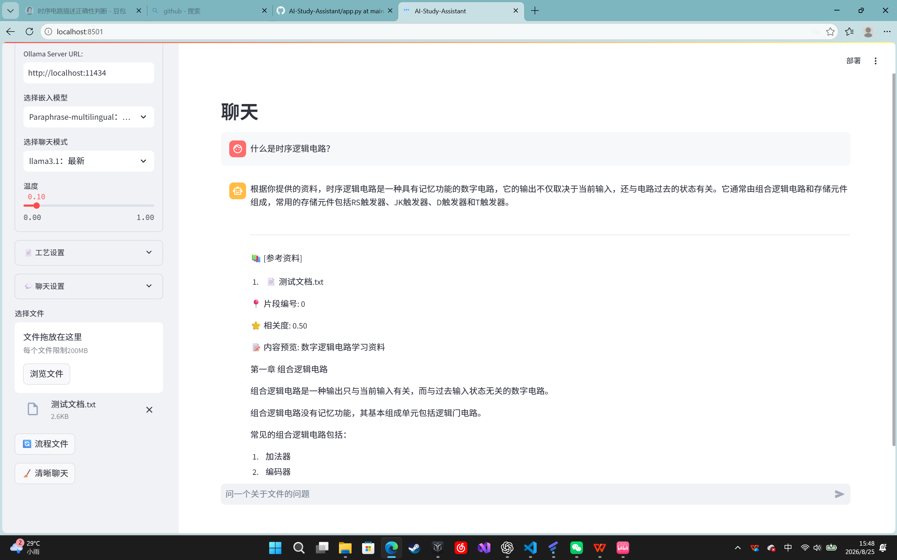
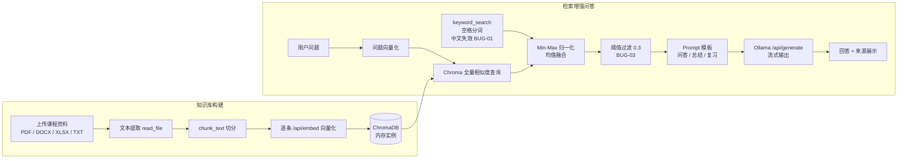

# AI Study Assistant 📚

基于 RAG（Retrieval-Augmented Generation，检索增强生成）与本地大语言模型的课程资料问答原型。

将个人课程资料（PDF / DOCX / XLSX / TXT）构建为本地知识库，围绕资料内容进行问答、总结与复习；使用 Ollama 在本地运行 LLM 与 Embedding 模型，回答附带检索来源。

> **当前状态（v1.0 原型，修复中）**
> 主流程已跑通，但代码审计确认存在多项影响检索质量与稳定性的缺陷（2 个 P0、多个 P1）。
> 本仓库暂不作为“已完成/可展示”的完整项目；修复计划见 [docs/DEBUG-REPORT.md](docs/DEBUG-REPORT.md) 与下方 [Roadmap](#-roadmap)，逐条修复进度见 [#21 缺陷修复总览看板](https://github.com/zhhan56-png/AI-Study-Assistant/issues/21)。
> 当前已知最严重的两个问题：**中文关键词检索实际失效（Hybrid 退化为纯向量）**、**向量库为内存模式（刷新即丢）**。



## ✨ 功能概览（含当前实现状态）

| 功能 | 状态 | 说明 |
| --- | --- | --- |
| PDF / DOCX / XLSX / TXT 解析 | ✅ 基本可用 | 扫描版 PDF、图片/公式/复杂表格无法提取，见 [已知限制](#-已知限制) |
| 文本切分（chunk_size / overlap） | ⚠️ 有缺陷 | 参数组合可触发死循环，见 BUG-04 |
| 文档摘要 | ⚠️ 有缺陷 | 整篇文本一次性塞入模型，长文档会被截断，见 BUG-06 |
| Embedding + ChromaDB 存储 | ⚠️ 有缺陷 | 使用内存实例，重启/刷新后知识库丢失，见 BUG-02 |
| 混合检索（语义 + 关键词） | ⚠️ 有缺陷 | 中文关键词检索失效，实际为纯向量检索，见 BUG-01 |
| 相关度阈值过滤 | ⚠️ 有缺陷 | 归一化分数不可解释，实际常只剩 1 条结果，见 BUG-03 |
| 智能问答 / 内容总结 / 考试复习 | ⚠️ 部分可用 | 总结与复习模式仍按问题做 top-k 检索，见 BUG-05 |
| 流式输出 + 多轮对话 | ✅ 基本可用 | 记忆窗口存在 off-by-one，见 BUG-13 |
| 来源展示（文件名 / 片段号 / 相关度） | ⚠️ 有缺陷 | 展示的是融合归一化分数，不是真实余弦相似度，见 BUG-03 |

## 🏗️ 系统架构（实际流程）



### 工作流程

1. 上传课程资料，`read_file` 提取文本。
2. `chunk_text` 按字符切分，记录文件名、片段编号、摘要与预览等元数据。
3. `embed_documents` 逐条调用 Ollama `/api/embed` 生成向量。
4. 向量写入 ChromaDB（当前为内存实例），摘要保存在会话状态中。
5. 提问后，`hybrid_search` 计算语义相似度与关键词得分，Min-Max 归一化后取均值融合并做阈值过滤。
6. 检索结果 + 文档摘要 + 最近对话拼入 Prompt，Ollama `/api/generate` 流式生成回答。
7. 页面展示回答、参考文件、片段编号、相关度与内容预览。

## 🛠️ 技术栈与实测环境

| 模块 | 技术 | 本机实测版本 |
| --- | --- | --- |
| Python | CPython | 3.11.15（conda env `ai-study`） |
| Web 界面 | Streamlit | 1.38.0 |
| LLM / Embedding | Ollama 本地服务 | 0.33.2（`llama3.1`、`paraphrase-multilingual`） |
| 向量数据库 | ChromaDB | 0.5.5（`chromadb.Client()` 内存模式） |
| 文档处理 | PyPDF2 / python-docx / openpyxl | 3.0.1 / 1.1.2 / 3.1.5 |

## 🚀 快速开始

### 1. 克隆项目

```bash
git clone https://github.com/zhhan56-png/AI-Study-Assistant.git
cd AI-Study-Assistant
```

### 2. 创建并激活环境

推荐 Python 3.11：

```bash
conda create -n ai-study python=3.11 -y
conda activate ai-study
```

### 3. 安装依赖

```bash
pip install -r requirements.txt
```

### 4. 准备 Ollama 模型

```bash
ollama serve          # 保持运行
ollama pull llama3.1  # 对话模型
ollama pull paraphrase-multilingual   # Embedding 模型（按你实际使用的模型名）
ollama list           # 确认模型已下载
```

> ⚠️ 注意：当前界面的“Select the embedding model”下拉框会列出 Ollama 中的**全部**模型，把对话模型误选为 Embedding 模型会直接返回 400，见 BUG-09。

### 5. 启动

```bash
streamlit run app.py
```

## 📖 使用方法

1. 启动 Ollama 与 Streamlit。
2. 在侧边栏选择 Embedding 模型与对话模型（注意区分，见上面的警告）。
3. 上传课程资料，点击 `🔄 Process Documents` 完成解析、切分、摘要与向量化。
4. 选择学习模式（智能问答 / 内容总结 / 考试复习）。
5. 提问并查看回答、参考文件、片段编号、相关度与内容预览。

## ⚠️ 已知问题（摘要）

完整问题清单、复现步骤、实测数据与修复计划见 **[docs/DEBUG-REPORT.md](docs/DEBUG-REPORT.md)**。

| ID | 严重度 | 问题 | 影响 |
| --- | --- | --- | --- |
| BUG-01 | P0 | 中文关键词检索失效（`keyword_search` 用 `split()` 空格分词） | Hybrid 检索退化为纯向量检索 |
| BUG-02 | P0 | ChromaDB 使用内存实例 `chromadb.Client()` | 刷新/重启后知识库丢失；分批上传无法累积 |
| BUG-03 | P1 | Min-Max 归一化 + 固定 0.3 阈值 | 结果数不稳定（中文场景常只剩 1 条），展示“相关度”不可解释 |
| BUG-04 | P1 | `chunk_text` 未校验 overlap < chunk_size | 特定参数（如 chunk=100、overlap=500）导致死循环卡死 |
| BUG-05 | P1 | 总结/复习模式仍按用户问题检索 top-k | “总结整篇内容”类问题答非所问 |
| BUG-06 | P1 | 文档摘要整篇塞入单次请求 | 长文档被模型上下文截断，摘要质量下降 |
| BUG-07 | P1 | 每个 chunk 的 metadata 重复存整份摘要 | 存储与请求体积放大 |
| BUG-08 | P2 | 所有文档摘要无条件进入 Prompt | 多文档时上下文膨胀、噪声增加 |
| BUG-09 | P2 | 模型下拉框不区分对话/Embedding 模型 | 选错即 400 报错 |
| BUG-10 | P2 | 生成请求无 timeout、无错误恢复 | 模型异常时页面卡死 |
| BUG-11 | P2 | Embedding 逐条请求、未批量 | 数百 chunk 需数百次网络往返，处理慢 |
| BUG-12 | P2 | 向量化失败时 `None` 直接传给 `collection.query` | 检索阶段抛异常 |
| BUG-13 | P2 | 记忆窗口把当前问题算进历史 | 记忆错位、少一轮上下文 |
| BUG-14 | P3 | 用 `/api/generate` + 单条 Prompt 而非 `/api/chat` | 无角色结构，历史拼接易失配 |
| BUG-15 | P3 | 死代码与未使用导入 | `process_documents()` 从未调用；`streamlit_chat`/`pathlib`/`Counter` 未使用 |
| BUG-16 | P3 | 工程化缺失 | 无测试 / CI / 日志；依赖锁定旧版 Streamlit；README 曾有多处错误 |

## 🔧 错误排查 / FAQ

| 现象 | 常见原因 | 处理 |
| --- | --- | --- |
| 400 报错 | 把对话模型选成了 Embedding 模型（界面无法区分）；或 Ollama 版本过旧不支持 `/api/embed` | 重新选择真正的 Embedding 模型；`ollama list` 确认模型；必要时升级 Ollama |
| 500 报错 | 模型未下载完成、显存/内存不足、模型崩溃 | 查看运行 `streamlit run` 的终端日志；`ollama ps` 观察模型状态；换更小模型重试 |
| 连接 Ollama 失败 | 未启动 `ollama serve`，或 URL 写错 | 启动 Ollama；核对侧边栏 `Ollama Server URL` |
| 刷新后知识库消失 | 当前使用内存向量库（BUG-02） | 重新上传处理；v1.1 将改为持久化 |
| 处理文档时页面卡死 | chunk_size / overlap 参数组合触发死循环（BUG-04） | 调大 chunk_size 或调小 overlap；v1.1 将加参数校验 |
| 显示 “Failed to generate summary.” | 摘要请求失败（模型/服务问题） | 检查 Ollama 日志；确认对话模型可用 |
| 回答不准确、引用不相关 | 检索质量缺陷（BUG-01 / 03 / 05） | 参见 [docs/DEBUG-REPORT.md](docs/DEBUG-REPORT.md) 的修复计划 |

## 🗺️ Roadmap

### v1.1 修复版（当前计划）

- [ ] BUG-01：jieba 分词 + BM25，替换现有 `keyword_search`
- [ ] BUG-02：改用 `chromadb.PersistentClient`，支持分批上传累积
- [ ] BUG-03：改为 RRF 融合 + 真实余弦相似度阈值，展示可解释分数
- [ ] BUG-04：参数校验（overlap 必须小于 chunk_size），UI 联动约束
- [ ] BUG-05/06：总结模式改为全文 map-reduce，长文档分块摘要
- [ ] BUG-09/10/11/12：模型类型过滤、请求超时、批量 Embedding、失败保护
- [ ] BUG-13/14：修正记忆窗口，迁移 `/api/chat`
- [ ] BUG-15/16：清理死代码；补充 pytest 基础测试与 CI；重写文档

### v2 重构（中长期）

- 拆分模块（`ingest` / `retriever` / `llm` / `ui`），去掉单文件 800+ 行
- 建立中文 RAG 评测集，做检索消融实验（向量 / BM25 / RRF / rerank）
- 支持引用溯源与答案校验；可选查询改写与重排
- 完善 README / DESIGN 文档与可复现实验记录

## 📁 项目结构

```text
AI-Study-Assistant/
├── app.py               # 全部逻辑（单文件，v1 原型）
├── requirements.txt     # 运行依赖
├── README.md            # 本文件
├── docs/
│   └── DEBUG-REPORT.md  # 错误排查与修复计划
├── images/
│   └── 1.png            # 界面截图
└── .streamlit/
    └── config.toml      # Streamlit 配置
```

## ⚠️ 已知限制

- 当前版本面向以文本内容为主的课程资料。扫描版 PDF、图片、公式、卡诺图、电路图、复杂表格无法可靠提取与还原。
- 检索质量受 Embedding 模型与切分策略影响较大，v1.0 尚无量化评测。
- 不包含 OCR / 多模态能力；后续可结合 OCR 或视觉模型扩展。

## 🤝 开发说明

- 本项目为个人学习项目，2026 年 8 月发布 v1.0，目前处于问题修复与工程化重构阶段。
- 提交规范：`fix:` / `docs:` / `refactor:` / `test:` 前缀；每个缺陷一个 issue 或一次提交，便于追溯。
- 问题跟踪：GitHub Issues（[#21 缺陷修复总览看板](https://github.com/zhhan56-png/AI-Study-Assistant/issues/21)，BUG-01 ~ BUG-20 已逐条建 issue）；缺陷详细分析与验收标准见 [docs/DEBUG-REPORT.md](docs/DEBUG-REPORT.md)。

## 📄 License

[MIT](LICENSE)
